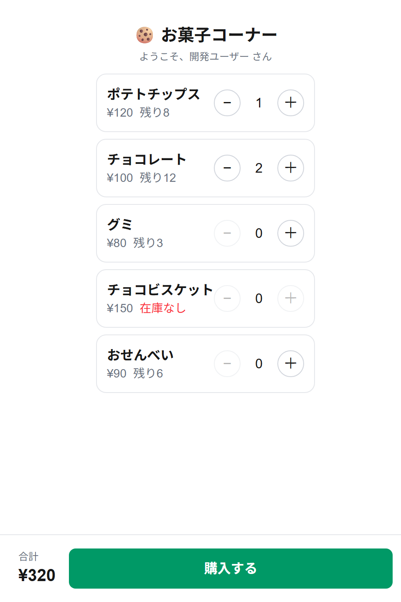
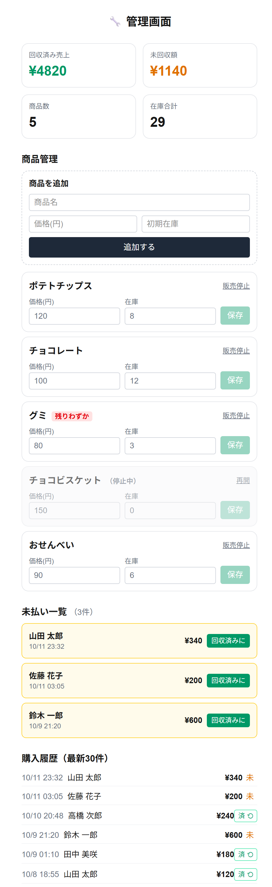

# okashi-manager 🍪

研究室のお菓子コーナーを無人販売で運用するためのWebアプリ。
掲示したQRコードから商品を選んで購入でき、**誰が・何を・いくら分買ったか**を記録して、在庫と未回収額を管理します。


## 画面

| 購入画面（購入者） | 管理画面（管理者） |
|:---:|:---:|
|  |  |

QRコードから開いて商品を選ぶ画面（左）と、売上・在庫・未払いを管理する画面（右）。<br>
※ スクリーンショットはサンプルデータです。

## 背景

お菓子コーナーの運用には3つの課題がありました。

| 課題 | このアプリでの解決 |
|------|------------------|
| 誰が買ったか分からない | LINEログインで購入者を必ず記録する |
| 現金・釣り銭の管理が煩雑 | 金額を記録し、集金はLINEのPayPay送金で行う |
| 在庫を把握できていない | 購入時に自動で在庫を減算し、管理画面で残数を確認する |

## 主な機能

**購入者（LINEログイン済みの全員）**

- 掲示されたQRコードからアプリを開き、LINEログインで本人を特定
- 商品一覧から数量を選んで購入（在庫数を超える数量は選択不可）
- 購入すると在庫が減り、購入履歴が未払いとして記録される

**管理者（`is_admin = true` のユーザーのみ）**

- 回収済み売上・未回収額・商品数・在庫合計のダッシュボード
- 商品の追加、価格・在庫の編集、販売停止／再開（在庫3個以下で「残りわずか」表示）
- 未払い一覧 — 集金作業の起点。入金確認後に「回収済みに」で記録
- 購入履歴（最新30件）と、誤操作の取り消し

## 技術スタック

| 層 | 採用技術 |
|----|----------|
| フロントエンド | Next.js 16（App Router）/ React 19 / TypeScript 5 |
| スタイル | Tailwind CSS v4 |
| サーバー処理 | Next.js Server Actions |
| データベース | Supabase（PostgreSQL） |
| 認証 | LINEログイン（LIFF）＋ サーバー側でのトークン検証 |
| ホスティング | Vercel |

## 設計上のポイント

### 同時購入でも在庫が破綻しない

購入処理はPostgreSQLの関数 `create_purchase` として実装し、`SELECT ... FOR UPDATE` で対象商品の行ロックを取得してから在庫確認・減算・購入記録の作成を行います。これらを単一トランザクションにまとめているため、2人が同時に最後の1個を購入しても在庫がマイナスになりません。途中で失敗した場合は在庫も購入記録も巻き戻ります。

### クライアントを信用しない認証

ブラウザから送られた `userId` をそのまま信用すると他人になりすませるため、クライアントからは**アクセストークンのみ**を送り、サーバーがLINEの `/v2/profile` に問い合わせて本人を確定します（検証結果はキャッシュしません）。

### DBアクセスをサーバーに限定

全テーブルでRLS（行レベルセキュリティ）を有効化し、**ポリシーを1つも作っていません。** これにより匿名キーからは一切読み書きできず、アプリはサーバー側から `service_role` キーでのみ操作します。

### 履歴が後から変わらない

`purchase_items.unit_price` に購入時点の単価を保存しているため、後から値上げしても過去の履歴や売上集計が変化しません。商品に削除機能を設けず販売停止で対応しているのも同じ理由です。

## 集金の運用

**このアプリは決済機能を持ちません。** 購入者の操作は「購入を記録する」までで、集金はアプリの外側で完結します。

1. 管理者が未払い一覧を確認する
2. 該当者にLINEで連絡する
3. 購入者がLINEのPayPay送金機能で送金する
4. 管理者が入金を確認し「回収済みに」を押す

PayPayの受け取りQRをアプリで表示する方式も検討しましたが、個人の受け取りQRは約2週間で期限が切れて差し替え作業が定期的に発生し、期限のないコードには加盟店登録（有料）が必要になるため採用していません。LINEログインで購入者が特定できているので、トーク上で完結させる方が運用の手間が少なくなります。

## セットアップ

外部サービス（Supabase / Vercel / LINE Developers）の準備手順は **[docs/SETUP.md](docs/SETUP.md)** にまとめています。

```bash
npm install
# .env.local に SUPABASE_URL と SUPABASE_SERVICE_ROLE_KEY を設定
npm run dev
```

`NEXT_PUBLIC_LIFF_ID` が未設定の場合は開発用ログインとして動作するため、LINEの設定なしでローカル確認ができます（`NODE_ENV=production` では無効）。

## ドキュメント

- **[docs/SPEC.md](docs/SPEC.md)** — 仕様書。画面仕様、Server Actions、データモデル、認証フロー、既知の制限
- **[docs/SETUP.md](docs/SETUP.md)** — 外部サービスのセットアップ手順

## ディレクトリ構成

```
src/
  app/
    page.tsx          購入画面
    admin/page.tsx    管理画面
  lib/
    actions.ts        購入者向け Server Actions
    admin-actions.ts  管理者向け Server Actions（requireAdmin 経由）
    auth.ts           トークン検証とユーザー確定
    line.ts           LINEアクセストークンの検証
    liff.ts           ブラウザ側のログイン処理
    supabase/server.ts  サーバー専用 Supabase クライアント
supabase/schema.sql   テーブル・RPC・RLS の定義
scripts/              運用・検証スクリプト
```

## 運用スクリプト

`node --env-file=.env.local scripts/<name>.mjs` で実行します。

| スクリプト | 用途 |
|-----------|------|
| `check-db.mjs` | DB接続とテーブルの存在確認 |
| `check-admin.mjs` | 管理画面の集計クエリの検証 |
| `list-users.mjs` | 登録ユーザーと管理者フラグの一覧 |
| `make-admin.mjs` | 指定ユーザーを管理者にする |
| `seed.mjs` | サンプル商品の投入 |
| `test-purchase.mjs` | `create_purchase` RPCの検証 |
| `make-qr.mjs` | 掲示用の入口QRを生成 |
