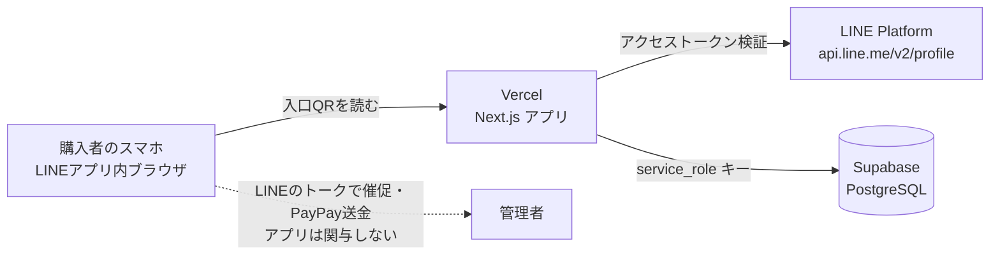
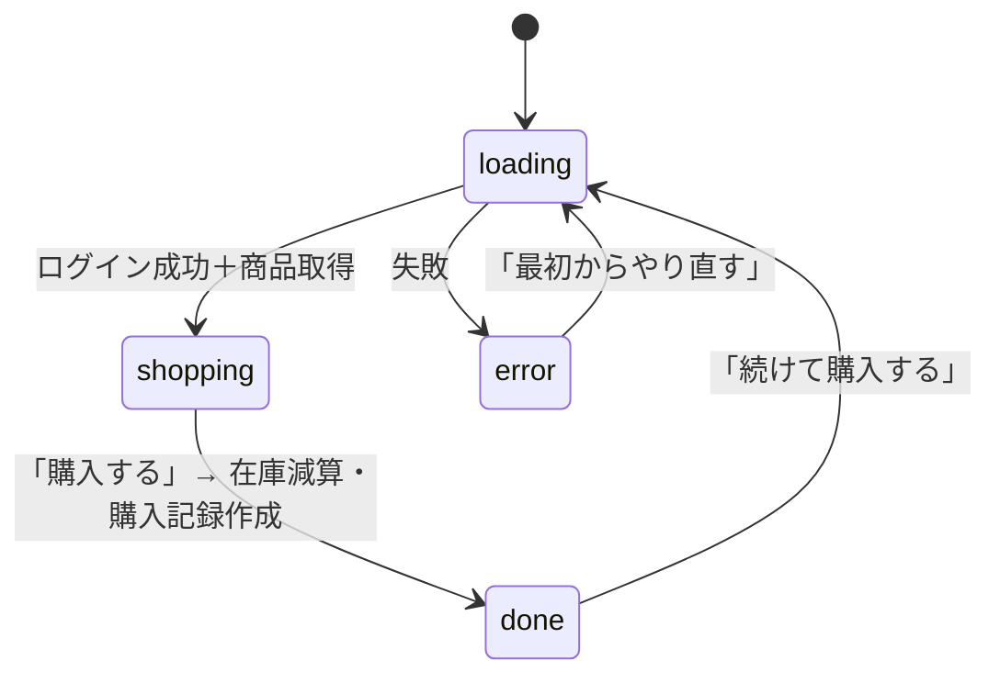
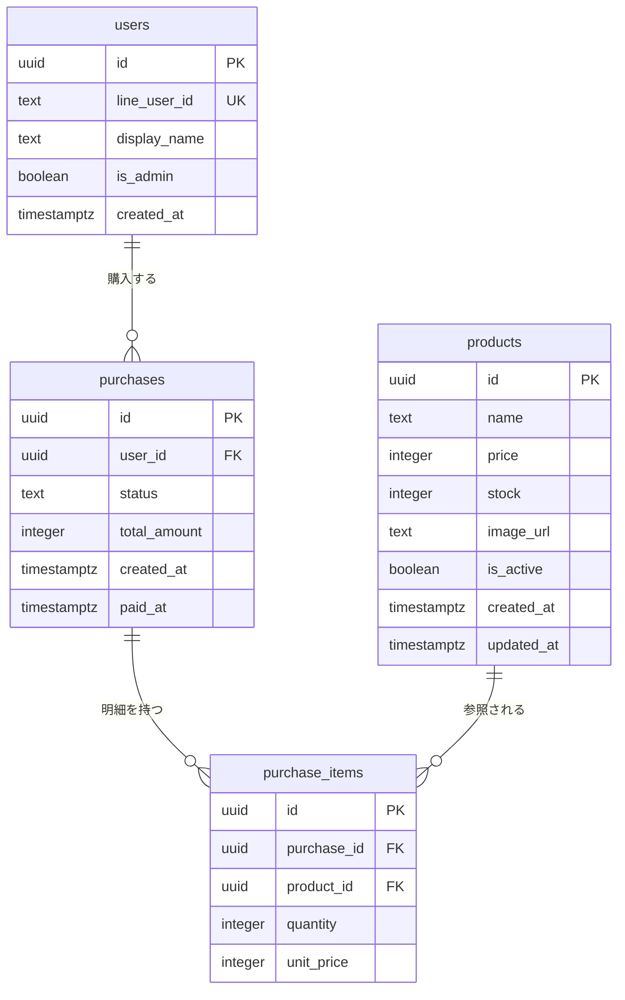
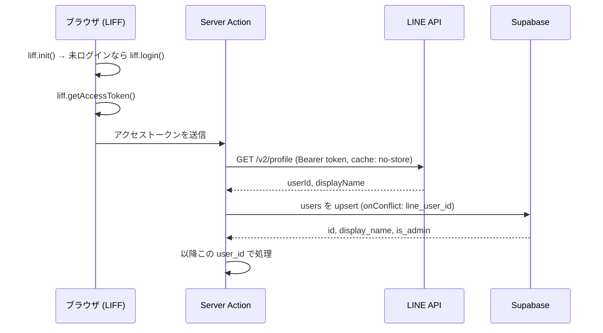
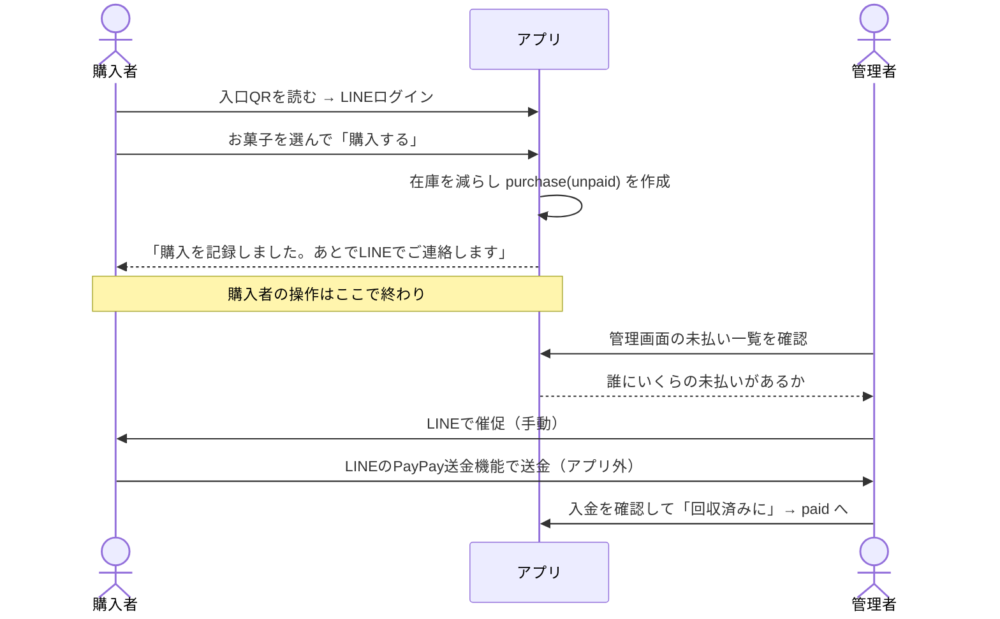

# お菓子管理アプリ 仕様書

- **アプリ名**: お菓子管理（パッケージ名 `okashi-manager`）
- **版**: 1.0（2026-08-25 時点の実装に基づく）
- **対象読者**: 開発を引き継ぐ人／運用担当（お菓子管理係）

---

## 1. 概要

### 1.1 目的

研究室のお菓子コーナーを **無人販売** で回すためのWebアプリ。
「誰が・何を・いくら分買ったか」を記録し、支払い状況（未払い／回収済み）と在庫を管理する。

### 1.2 背景と基本方針

現金箱の管理・釣り銭・在庫の把握を手作業でやると管理係の負担が大きい。そこで次の3点で省力化する。

| 課題 | 解決方法 |
|------|----------|
| 誰が買ったか分からない | LINEログイン（LIFF）で購入者を必ず記録する |
| 現金・釣り銭の管理 | アプリでは金額を記録するだけ。集金は後日LINEのPayPay送金で行う |
| 在庫の把握 | 購入時に自動で在庫を減算、管理画面で残数を確認 |

### 1.3 決済に関する重要な前提

**本アプリは決済機能を一切持たない。** 購入者がアプリで行うのは「お菓子を選んで購入を記録する」ところまでで、支払いはアプリの外側で完結する。

集金の流れは次の通り。

1. 管理者が管理画面の**未払い一覧**を見て、誰にいくらの未払いがあるかを把握する
2. 管理者がその人に**LINEで催促**する（手動）
3. 購入者が**LINEのPayPay送金機能**で管理者に送金する
4. 管理者が入金を確認し、管理画面で「回収済みに」を押す

この設計を選んだ理由：

- PayPayの個人向け受け取りQRは**約2週間で期限が切れる**ため、アプリに取り込むと差し替え作業が定期的に発生する。期限のないコードを使うには加盟店登録（有料）が必要になる。
- LINEログインで購入者が特定できているので、**そのままLINEのトーク上で催促・送金まで完結できる**。QRを掲示する必要がない。
- 研究室内という**信用ベースのクローズドな環境**を前提とした割り切り。

したがって、購入者側に「支払いました」という自己申告の導線は**存在しない**。支払い状態を変更できるのは管理者だけ。

### 1.4 スコープ外（実装しないこと）

- PayPay決済APIとの連携、入金の自動照合
- アプリ内でのPayPay QR表示・送金導線（LINEのトークで行う）
- 未払い者への自動通知・催促（LINEメッセージ送信は未実装。催促は手動）
- 購入者による支払い状況の確認・自己申告
- 購入のキャンセル／返品（在庫の自動戻し）
- 複数拠点・複数のお菓子コーナーの管理
- 会計ソフト連携、レシート発行

---

## 2. 用語

| 用語 | 意味 |
|------|------|
| 入口QR | お菓子コーナーに掲示する、アプリを開くためのQRコード（`entry-qr.png`）。**アプリが扱うQRはこれだけ** |
| 購入（purchase） | 1回の会計単位。複数商品をまとめて1レコードとする |
| 明細（purchase_item） | 購入に含まれる商品ごとの行（商品・数量・購入時単価） |
| 未払い / 回収済み | 購入の状態。`unpaid` / `paid` の2値 |
| LIFF | LINE Front-end Framework。LINEアプリ内でWebページを開き、ログイン情報を得る仕組み |

---

## 3. 利用者と権限

| ロール | 判定方法 | できること |
|--------|----------|-----------|
| 購入者（一般） | LINEログイン済みの全員。初回アクセス時に `users` へ自動登録 | 商品閲覧、購入のみ |
| 管理者 | `users.is_admin = true` | 上記に加えて `/admin` の全機能（支払い状態の変更を含む） |

- 管理者フラグはアプリのUIからは変更できない。運用スクリプト `scripts/make-admin.mjs` でDBを直接更新する（意図しない権限昇格を防ぐため）。
- 一般ユーザーが `/admin` を開くと「管理者専用ページです」と表示され、データは一切返らない（サーバー側で `requireAdmin` が例外を投げる）。

---

## 4. システム構成

### 4.1 技術スタック

| 層 | 採用技術 |
|----|----------|
| フロントエンド | Next.js 16.2.10（App Router）/ React 19.2.4 / TypeScript 5 |
| スタイル | Tailwind CSS v4（`@tailwindcss/postcss`） |
| サーバー処理 | Next.js Server Actions（`"use server"`） |
| データベース | Supabase（PostgreSQL） |
| 認証 | LINEログイン（`@line/liff` 2.29.x）+ サーバー側トークン検証 |
| ホスティング | Vercel |
| QR生成 | `qrcode`（devDependency、入口QRの生成スクリプトで使用） |

### 4.2 構成図



### 4.3 ディレクトリ構成

```
src/
  app/
    page.tsx          購入画面（購入者向け・クライアントコンポーネント）
    admin/page.tsx    管理画面（管理者向け・クライアントコンポーネント）
    layout.tsx        共通レイアウト（lang="ja"、Geistフォント）
  lib/
    actions.ts        購入者向け Server Actions
    admin-actions.ts  管理者向け Server Actions（全て requireAdmin 経由）
    auth.ts           トークン→ユーザー確定、管理者チェック
    line.ts           LINEアクセストークンの検証
    liff.ts           ブラウザ側のログイン処理
    types.ts          共通型定義
    supabase/server.ts  サーバー専用 Supabase クライアント
supabase/
  schema.sql        テーブル・RPC・RLS の定義
scripts/            運用・検証スクリプト（後述）
docs/SETUP.md       外部サービスのセットアップ手順
entry-qr.png        掲示用の入口QR
```

---

## 5. 画面仕様

### 5.1 購入画面 `/`（`src/app/page.tsx`）

単一ページ内で4つのフェーズを切り替える。**支払いに関する画面はない。**



#### loading

初期化処理。LIFF初期化 → LINEログイン → 商品一覧を取得。

#### shopping（商品選択）

- ヘッダーに `🍪 お菓子コーナー` と `ようこそ、{LINE表示名} さん`
- `is_active = true` の商品を、`created_at` 昇順（同値は `id` 昇順）で一覧表示
  - 表示項目：商品名、価格、`残り{n}` または `在庫なし`（赤字）
  - `＋` `−` ボタンで数量指定。**在庫数を超える数量は選べない**（`＋` が無効化）
  - 在庫0の商品は `＋` が無効
- カートに1点以上入ると画面下部に会計バーが固定表示され、合計金額と「購入する」ボタンを出す

#### done（購入完了）

`🍪 ありがとうございました！` と購入金額 `¥{合計}` を表示し、続けて案内文を出す。

> 購入を記録しました。
> お支払いは、あとでお菓子管理係からLINEでご連絡します。

「続けて購入する」で shopping に戻る。

この時点で**在庫は減り、購入記録は `unpaid` で作成済み**。購入者の操作はここで終わり、以降の集金は管理者が主導する。

#### error

エラーメッセージと「最初からやり直す」ボタン。

### 5.2 管理画面 `/admin`（`src/app/admin/page.tsx`）

管理者以外は `unauthorized` フェーズで内容を表示しない。

#### ① ダッシュボード（2×2のカード）

| 指標 | 内容 |
|------|------|
| 回収済み売上 | `status = 'paid'` の `total_amount` 合計（全期間） |
| 未回収額 | `status = 'unpaid'` の `total_amount` 合計（全期間） |
| 商品数 | `products` の全件数（販売停止中も含む） |
| 在庫合計 | 全商品の `stock` 合計 |

#### ② 商品管理

- **追加フォーム**：商品名／価格（円）／初期在庫 を入力して「追加する」
- **商品一覧**（販売停止中も表示、停止中は半透明＋「（停止中）」表示）
  - 価格・在庫をその場で編集し「保存」（変更がない間はボタン無効）
  - 「販売停止」／「再開」で `is_active` をトグル
  - 在庫が **3個以下** の販売中商品には「残りわずか」バッジ（`LOW_STOCK = 3`）
- 商品の**削除機能はない**。販売停止で対応する（購入履歴の整合性を保つため）

#### ③ 未払い一覧

**集金作業の起点となる画面。** 未払いの購入を件数付きで表示（購入日時降順）。各行に購入者名・日時・金額と「回収済みに」ボタン。0件のときは「未払いはありません 🎉」。

ここに出ている購入者へLINEで催促し、LINEのPayPay送金で入金を受けたら「回収済みに」を押す。

#### ④ 購入履歴（最新30件）

日時・購入者・金額・状態を一覧表示。

- `paid` の行には「済 ⟲」ボタン → 押すと `unpaid` に戻せる（誤操作の取り消し用）
- `unpaid` の行には「未」（オレンジ）を表示
- 明細（どのお菓子を何個）は表示しない。合計金額のみ

---

## 6. 機能仕様（Server Actions）

すべてのDB操作はサーバー側に集約し、ブラウザからSupabaseへ直接アクセスさせない。

### 6.1 購入者向け（`src/lib/actions.ts`）

| 関数 | 引数 | 戻り値 | 説明 |
|------|------|--------|------|
| `getProducts()` | — | `Product[]` | `is_active = true` の商品を `created_at`→`id` 昇順で取得。**認証不要** |
| `submitPurchase(token, items)` | LINEトークン、`{product_id, quantity}[]` | `{ purchaseId, total, userName }` | トークン検証 → RPC `create_purchase` で在庫減算と購入記録をアトミックに作成 |

購入者向けのアクションはこの2つだけ。**支払い状態を変更するアクションは購入者側に存在しない**（管理者の `setPurchasePaid` のみ）。

### 6.2 管理者向け（`src/lib/admin-actions.ts`）

すべて先頭で `requireAdmin(token)` を呼ぶ。

| 関数 | 説明 | バリデーション |
|------|------|----------------|
| `getAdminData(token)` | 商品一覧・統計・未払い一覧・履歴（最新30件）を一括取得 | — |
| `addProduct(token, {name, price, stock})` | 商品追加 | 商品名必須（trim後）、価格・在庫は0以上の整数 |
| `updateProduct(token, id, patch)` | 名前・価格・在庫・販売状態の部分更新。`updated_at` を自動更新 | 同上（指定された項目のみ検証） |
| `setPurchasePaid(token, purchaseId, paid)` | 支払い状態を手動で切り替え。`paid=false` なら `paid_at` を `null` に戻す | — |

### 6.3 エラーハンドリング

- サーバー側は日本語メッセージの `Error` を投げる（例：「在庫不足です（ポテトチップス）: 残り2個, 要求3個」「管理者権限がありません」）
- クライアントは `catch` してエラー画面またはフォーム下部に赤字表示
- 管理画面はメッセージに「管理者権限」を含むかで `unauthorized` / `error` を出し分ける

---

## 7. データモデル

### 7.1 ER図



### 7.2 テーブル定義（`supabase/schema.sql`）

#### users — 研究室メンバー（LINEアカウントと1対1）

| カラム | 型 | 制約 | 説明 |
|--------|----|------|------|
| id | uuid | PK, default `gen_random_uuid()` | 内部ID |
| line_user_id | text | UNIQUE, NOT NULL | LINEの userId |
| display_name | text | NOT NULL | LINE表示名。ログインのたびに最新化 |
| is_admin | boolean | NOT NULL, default false | 管理者フラグ |
| created_at | timestamptz | NOT NULL, default now() | 初回ログイン日時 |

#### products — お菓子

| カラム | 型 | 制約 | 説明 |
|--------|----|------|------|
| id | uuid | PK | |
| name | text | NOT NULL | 商品名 |
| price | integer | NOT NULL, `>= 0` | 価格（円） |
| stock | integer | NOT NULL, default 0, `>= 0` | 在庫数 |
| image_url | text | NULL可 | 商品画像URL（**現状UI未使用。将来拡張用**） |
| is_active | boolean | NOT NULL, default true | 販売中フラグ |
| created_at / updated_at | timestamptz | NOT NULL, default now() | |

#### purchases — 購入（1回の会計単位）

| カラム | 型 | 制約 | 説明 |
|--------|----|------|------|
| id | uuid | PK | |
| user_id | uuid | NOT NULL, FK→users.id | 購入者 |
| status | text | NOT NULL, default `'unpaid'`, CHECK in (`unpaid`,`paid`) | 支払い状態 |
| total_amount | integer | NOT NULL, default 0, `>= 0` | 合計金額のスナップショット |
| created_at | timestamptz | NOT NULL, default now() | 購入日時 |
| paid_at | timestamptz | NULL可 | 支払い日時（未払いは null） |

#### purchase_items — 購入明細

| カラム | 型 | 制約 | 説明 |
|--------|----|------|------|
| id | uuid | PK | |
| purchase_id | uuid | NOT NULL, FK→purchases.id **ON DELETE CASCADE** | |
| product_id | uuid | NOT NULL, FK→products.id | |
| quantity | integer | NOT NULL, `> 0` | 数量 |
| unit_price | integer | NOT NULL, `>= 0` | **購入時点の単価**（後から値上げしても履歴が狂わない） |

#### インデックス

`idx_purchases_user`（purchases.user_id）／`idx_purchases_status`（purchases.status）／`idx_purchase_items_pur`（purchase_items.purchase_id）

### 7.3 RPC `create_purchase(p_user_id uuid, p_items jsonb)`

購入を**1トランザクションで**作成するPL/pgSQL関数。戻り値は `(purchase_id uuid, total_amount integer)`。

処理順序：

1. `p_items` が空なら「カートが空です」で例外
2. `purchases` を `status='unpaid'`, `total_amount=0` で先に作成
3. 明細ごとにループ
   - 数量が0以下なら「数量が不正です」で例外
   - `select ... from products where id = ? and is_active = true **for update**` で**行ロック**して価格・在庫を取得
   - 商品が見つからなければ例外
   - 在庫不足なら「在庫不足です（商品名）: 残りN個, 要求M個」で例外
   - `products.stock` を減算、`purchase_items` を挿入、合計に加算
4. `purchases.total_amount` を確定値で更新

`for update` により、2人が同時に最後の1個を買っても**在庫がマイナスにならない**。例外が起きればトランザクション全体がロールバックされ、在庫も購入記録も残らない。

---

## 8. 認証・認可・セキュリティ

### 8.1 認証フロー



**なりすまし防止の要点**：クライアントから `userId` を受け取って信用することはしない。必ずアクセストークンを送らせ、サーバーがLINE APIに問い合わせて本人を確定する。トークン検証はキャッシュせず毎回実行する（`cache: "no-store"`）。

`users` の upsert では `is_admin` をpayloadに含めないため、ログインのたびに管理者フラグが上書きされることはない。

### 8.2 開発用ログイン

`NEXT_PUBLIC_LIFF_ID` が未設定のとき、クライアントは `token = "DEV"` を送る。サーバーは `line_user_id = "DEV_USER"`、表示名「開発ユーザー」として扱う。

**`NODE_ENV=production` では明示的に例外を投げて拒否する**ため、本番環境で開発ログインは使えない。

### 8.3 DBアクセス制御

- 全テーブルで **RLS（行レベルセキュリティ）を有効化し、ポリシーを1つも作らない**
  → 匿名キー・一般クライアントからは一切読み書きできない
- アプリはサーバー側から **`service_role` キー**でアクセス（service_roleはRLSを無視できる）
- `service_role` キーは `NEXT_PUBLIC_` を付けない環境変数で管理し、ブラウザには絶対に渡さない
- `SUPABASE_URL` は `new URL(url).origin` で正規化してから使用（末尾に `/rest/v1/` 等が付いていても動く）

### 8.4 権限昇格の防止

管理者フラグを変更するUIはアプリ内に存在しない。付与は `scripts/make-admin.mjs` によるDB直接操作のみ。

---

## 9. 業務フロー（運用の全体像）

### 9.1 購入から回収まで



### 9.2 管理者の定期作業

| 頻度 | 作業 |
|------|------|
| 週1回程度 | **未払い一覧を見て、該当者にLINEで催促する**。入金を確認したら「回収済みに」を押す |
| 補充のたび | 管理画面で在庫を実数に更新、新商品を追加 |
| 在庫僅少バッジが出たら | 買い出し |

集金は管理者が起点になるため、未払い一覧を定期的に見る習慣が運用の要になる。

### 9.3 初期セットアップ

詳細は `docs/SETUP.md`。要点のみ：

1. Supabaseでプロジェクト作成 → `supabase/schema.sql` を SQL Editor で実行
2. GitHubへpush → Vercelでインポート、環境変数を設定してデプロイ
3. LINE Developersで LINEログインチャネル + LIFFアプリを作成（サイズ Full、scope: `profile`, `openid`、エンドポイントはVercelのURL）
4. `NEXT_PUBLIC_LIFF_ID` を `.env.local` とVercel両方に設定
5. 自分が一度ログイン → `node --env-file=.env.local scripts/make-admin.mjs <line_user_id>` で管理者化
6. `node scripts/make-qr.mjs "https://liff.line.me/<LIFF_ID>" entry-qr.png` で入口QRを生成し、印刷して掲示
7. 管理画面から商品を登録する

PayPay側の準備は不要（集金はLINEのトーク上で行うため）。

---

## 10. 環境変数

`.env.local`（ローカル）と Vercel の環境変数に同じ値を設定する。

| 変数名 | 公開範囲 | 必須 | 用途 |
|--------|----------|------|------|
| `SUPABASE_URL` | サーバーのみ | ✅ | SupabaseのProject URL |
| `SUPABASE_SERVICE_ROLE_KEY` | サーバーのみ | ✅ | RLSを越えてDB操作するための鍵。**絶対に公開しない** |
| `NEXT_PUBLIC_LIFF_ID` | クライアントに露出 | 本番は必須 | LIFF ID。未設定だと開発ログインモードになる |

未設定時は `createServerSupabase()` が「Supabaseの環境変数が未設定です。…」という日本語エラーを投げる。

---

## 11. 運用・検証スクリプト（`scripts/`）

いずれも `node --env-file=.env.local scripts/<name>.mjs` で実行（`make-qr.mjs` を除く）。

| スクリプト | 用途 |
|-----------|------|
| `check-db.mjs` | Supabaseへの接続とテーブル存在確認 |
| `check-admin.mjs` | 管理画面の集計クエリ（purchases×usersの埋め込み）が動くか検証 |
| `list-users.mjs` | 登録済みユーザーと管理者フラグの一覧表示 |
| `make-admin.mjs [line_user_id]` | 指定ユーザーを管理者にする。引数省略時は `DEV_USER` |
| `seed.mjs` | サンプル商品を投入（既に商品があればスキップ） |
| `test-purchase.mjs` | `create_purchase` RPCの検証。テストデータは自動削除 |
| `make-qr.mjs <URL> [出力名]` | 入口QRのPNGを生成 |

---

## 12. 非機能要件・制約

### 12.1 想定規模

研究室単位（数十人、1日数件〜数十件の購入）。Supabase・Vercelの無料枠で運用可能な範囲。

### 12.2 対応環境

- 主にLINEアプリ内ブラウザ（LIFF）。UIは `max-w-md` のモバイル前提レイアウト
- ダークモード対応（Tailwindの `dark:` バリアント）

### 12.3 データ整合性

- 在庫の同時更新は `for update` の行ロックで保護
- 購入時の単価を `purchase_items.unit_price` に保存するため、後からの値上げが過去履歴に影響しない
- `total_amount` も購入時点のスナップショット

### 12.4 既知の制限・今後の課題

| 項目 | 現状 | 備考 |
|------|------|------|
| 購入の取り消し | 不可 | 誤購入時は管理者が在庫を手動で戻す必要がある |
| 未払いの催促 | 手動 | 管理者がLINEのトークで個別に連絡する。LINE Messaging API による自動送信は未実装 |
| 入金の確認 | 手動 | 管理者がLINE／PayPayの通知を見て「回収済みに」を押す |
| 購入明細の表示 | 合計のみ | `purchase_items` は保存済みなので画面追加で対応可能 |
| 商品画像 | 未使用 | `products.image_url` は定義済みだがUIから設定・表示しない |
| 集計期間 | 全期間の累計のみ | 月次集計・期間絞り込みは未実装 |
| 購入者の自己履歴閲覧 | なし | 自分の未払い額をアプリで確認できない。金額は購入完了画面とLINEの催促で伝わる |

---

## 13. 参考

- セットアップ手順: `docs/SETUP.md`
- DBスキーマ: `supabase/schema.sql`
- Next.js のバージョン固有仕様: `node_modules/next/dist/docs/`（`AGENTS.md` の指示に従い、実装前に参照すること）
